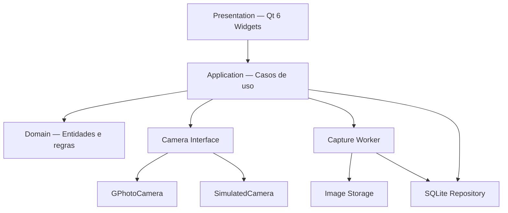

# AstroCapture

Software desktop para captura e processamento de imagens astronômicas, desenvolvido em C++ com Qt 6. O projeto tem como objetivo oferecer um fluxo integrado para controlar câmeras, organizar sessões de astrofotografia, empilhar imagens e realizar ajustes básicos de processamento.

> **Status do projeto:** em desenvolvimento — a primeira etapa é dedicada ao módulo de captura, com suporte a uma câmera simulada e integração com câmeras reais via libgphoto2.

## Objetivo

O AstroCapture busca simplificar o processo de aquisição e organização de imagens astronômicas, oferecendo ferramentas para controlar sessões de captura e preparar os dados para as etapas posteriores de processamento.

O projeto está dividido em três módulos principais:

- **Captura:** conexão com a câmera, configuração dos parâmetros fotográficos, execução de sequências e armazenamento das imagens.
- **Empilhamento:** importação, calibração, alinhamento e combinação de múltiplas imagens para gerar uma imagem resultante.
- **Edição:** ajustes básicos de imagem, aplicação de filtros e visualização dos resultados.

O desenvolvimento será incremental, começando pela captura e estabelecendo uma arquitetura que permita incorporar os demais módulos sem comprometer as funcionalidades existentes.

## Tecnologias utilizadas

| Tecnologia | Finalidade |
|---|---|
| C++ | Linguagem principal do projeto. |
| Qt 6 Widgets | Construção da interface gráfica desktop. |
| libgphoto2 | Comunicação e controle de câmeras compatíveis. |
| SQLite | Persistência de sessões, sequências, capturas e metadados. |
| CMake | Configuração do build e gerenciamento do projeto. |
| Git | Controle de versão. |

O desenvolvimento inicial tem como plataforma de referência o Linux, utilizando o Fedora como ambiente de validação.

## Arquitetura

O AstroCapture utiliza uma arquitetura modular, separando a interface gráfica, os casos de uso, as regras de negócio e os detalhes de infraestrutura.

A comunicação entre esses componentes deve ocorrer por meio de interfaces bem definidas, reduzindo o acoplamento e facilitando os testes automatizados.

### Visão geral



### Camadas da aplicação

**Presentation**

Responsável pela interface gráfica, navegação, formulários, visualização das imagens e apresentação do estado da captura.

**Application**

Coordena os casos de uso, como criação de sessões, início de sequências, interrupção segura, retomada e consulta de estatísticas.

**Domain**

Contém as entidades, os estados e as regras centrais do sistema, incluindo sessões, sequências, capturas e configurações fotográficas.

**Infrastructure**

Implementa a comunicação com as câmeras, o acesso ao SQLite, o armazenamento de arquivos e os mecanismos de registro de eventos.

### Abstração de câmera

A comunicação com a câmera será definida por uma interface comum, implementada por dois componentes:

- `GPhotoCamera`: integração com câmeras físicas compatíveis por meio da libgphoto2.
- `SimulatedCamera`: simulação das operações de captura, permitindo desenvolver e testar a aplicação sem depender de hardware.

A simulação terá dois modos: básico, para testes rápidos, e realista, para testar duração das exposições, transferências, interrupções e falhas controladas.

### Execução assíncrona

Operações demoradas, como exposições, transferências e gravação de imagens, serão executadas fora da thread principal da interface.

O Qt Signals & Slots será utilizado para comunicar os resultados ao restante da aplicação sem bloquear a interface gráfica.

O acesso à câmera física será serializado para evitar operações concorrentes incompatíveis.

## Organização das pastas

A estrutura inicial planejada é:

```text
AstroCapture/
├── CMakeLists.txt
├── CMakePresets.json
├── README.md
├── docs/
│   ├── architecture.md
│   ├── capture-workflow.md
│   └── decisions/
├── src/
│   ├── app/
│   ├── domain/
│   │   ├── camera/
│   │   ├── capture/
│   │   ├── session/
│   │   └── image/
│   ├── application/
│   │   ├── capture/
│   │   └── session/
│   ├── infrastructure/
│   │   ├── camera/
│   │   │   ├── gphoto/
│   │   │   └── simulator/
│   │   ├── persistence/
│   │   └── storage/
│   └── presentation/
│       ├── windows/
│       ├── views/
│       ├── widgets/
│       └── workers/
├── resources/
├── migrations/
└── tests/
    ├── unit/
    └── integration/
```

Essa estrutura representa a organização prevista para o projeto. Os diretórios serão criados conforme cada módulo for implementado.

### Responsabilidades dos principais diretórios

| Diretório | Responsabilidade |
|---|---|
| `src/app/` | Inicialização e configuração da aplicação. |
| `src/domain/` | Entidades, tipos e regras de negócio. |
| `src/application/` | Casos de uso e coordenação dos serviços. |
| `src/infrastructure/camera/` | Implementações das câmeras real e simulada. |
| `src/infrastructure/persistence/` | Repositórios e acesso ao SQLite. |
| `src/infrastructure/storage/` | Organização e gravação das imagens. |
| `src/presentation/` | Janelas, telas, widgets e workers. |
| `resources/` | Ícones, imagens e demais recursos visuais. |
| `migrations/` | Evolução do esquema do banco de dados. |
| `tests/unit/` | Testes unitários das regras e componentes. |
| `tests/integration/` | Testes de integração entre os componentes. |
| `docs/` | Documentação técnica e decisões de arquitetura. |

## Requisitos funcionais

Os requisitos abaixo representam o escopo planejado para o módulo de captura.

| ID | Requisito |
|---|---|
| RF-001 | Criar uma sessão com nome e tipo de fluxo. |
| RF-002 | Listar, abrir, salvar e retomar sessões existentes. |
| RF-003 | Utilizar uma câmera física ou simulada. |
| RF-004 | Consultar os recursos e parâmetros disponíveis na câmera. |
| RF-005 | Configurar ISO, obturador e tempo de exposição, conforme o suporte do dispositivo. |
| RF-006 | Executar capturas individuais. |
| RF-007 | Executar sequências com quantidade definida de imagens. |
| RF-008 | Executar capturas contínuas com parada segura. |
| RF-009 | Classificar imagens como Light, Dark, Flat, Bias ou Dark Flat. |
| RF-010 | Transferir e salvar as imagens individualmente. |
| RF-011 | Exibir a última imagem, o progresso e as estatísticas da sessão. |
| RF-012 | Retomar sessões em outras noites sem perder o histórico. |
| RF-013 | Registrar erros e permitir recuperação controlada. |
| RF-014 | Controlar o Live View manualmente. |
| RF-015 | Registrar logs e histórico das capturas. |
| RF-016 | Disponibilizar simulação básica e realista. |
| RF-017 | Organizar capturas de diferentes noites dentro da mesma sessão. |
| RF-018 | Exibir uma pré-visualização das imagens capturadas. |

O empilhamento e a edição estão previstos para etapas posteriores e não fazem parte do primeiro marco funcional.

## Requisitos não funcionais

- **Responsividade:** operações demoradas não devem bloquear a interface gráfica.
- **Integridade:** uma imagem só será marcada como concluída após transferência, validação e gravação bem-sucedidas.
- **Preservação dos originais:** os arquivos RAW serão armazenados sem conversão ou alteração do conteúdo original.
- **Persistência:** sessões e metadados concluídos deverão continuar disponíveis após o encerramento da aplicação.
- **Recuperação:** falhas e interrupções não devem provocar sobrescrita silenciosa de imagens.
- **Testabilidade:** as regras de negócio deverão ser testáveis sem uma câmera física.
- **Desacoplamento:** a lógica de captura não deverá depender diretamente dos widgets da interface.
- **Diagnóstico:** falhas deverão gerar registros que ajudem a identificar a etapa e a causa do problema.
- **Compatibilidade:** recursos fotográficos serão habilitados conforme as capacidades efetivas de cada câmera.

## Regras de captura

### Live View

- O usuário poderá iniciar e encerrar o Live View manualmente.
- O Live View não poderá permanecer ativo durante uma captura.
- Após uma captura, o Live View não será reativado automaticamente.
- A interface deverá refletir o estado real da câmera.

### Captura contínua

- Ao solicitar a parada, nenhuma nova exposição será iniciada.
- Uma exposição em andamento deverá terminar normalmente.
- A imagem em andamento será transferida e salva antes do encerramento da sequência, quando possível.
- Falhas de transferência deverão ser registradas e tratadas sem contabilizar a imagem como concluída.

### Transferência de imagens

Cada imagem seguirá o fluxo:

1. Execução da exposição.
2. Transferência para o dispositivo.
3. Gravação em arquivo temporário.
4. Validação do arquivo recebido.
5. Movimentação para o destino definitivo.
6. Registro dos metadados no SQLite.
7. Atualização da interface.

Os arquivos temporários e os registros de estado deverão permitir identificar operações incompletas durante a recuperação de uma sessão.

## Organização dos dados

Os metadados serão persistidos no SQLite, enquanto as imagens serão armazenadas no sistema de arquivos.

A organização proposta para os dados é:

```text
AstroCaptureData/
└── Targets/
    └── M42/
        └── Sessao01/
            ├── session.json
            ├── 2026-10-14/
            │   ├── Light/
            │   ├── Dark/
            │   ├── Flat/
            │   ├── Bias/
            │   ├── DarkFlat/
            │   └── Logs/
            └── 2026-10-17/
                ├── Light/
                ├── Dark/
                ├── Flat/
                ├── Bias/
                ├── DarkFlat/
                └── Logs/
```

Cada sessão poderá conter capturas realizadas em diferentes noites. A data identifica a noite de aquisição, enquanto o identificador da sessão mantém a relação entre todas as imagens daquele trabalho.

O arquivo `session.json` será um manifesto auxiliar. O SQLite será a fonte principal dos metadados gerenciados pela aplicação.

### Persistência

O esquema inicial do banco de dados deverá contemplar:

- `targets`: identificação dos alvos astronômicos.
- `sessions`: nome, alvo, fluxo e estado da sessão.
- `capture_runs`: sequências e informações de cada noite de captura.
- `frames`: caminhos, parâmetros, tipos e estados das imagens.

O tempo total de exposição será calculado a partir das capturas concluídas, considerando os tempos efetivamente registrados.

### Formatos de imagem

O AstroCapture preservará os arquivos originais recebidos da câmera, incluindo a extensão original. A Canon T6, por exemplo, normalmente produz arquivos RAW no formato Canon `.CR2`.

A pré-visualização deverá utilizar uma representação apropriada da imagem, sem modificar o arquivo original armazenado.

## Ambiente de desenvolvimento

### Pré-requisitos

- Sistema Linux para o ambiente inicial de desenvolvimento.
- Compilador C++20, como GCC ou Clang.
- CMake 3.21 ou mais recente.
- Pacote de desenvolvimento do Qt 6, incluindo Qt Widgets e Qt Test.  instale `qt6-qtbase-devel` (o pacote runtime do Qt sozinho não inclui os arquivos CMake necessários para compilar).
- Bibliotecas de desenvolvimento da libgphoto2.
- SQLite.
- Git.

No Fedora, instale as ferramentas e os componentes Qt com:

```bash
sudo dnf install cmake gcc-c++ qt6-qtbase-devel
```

### Compilação

Após instalar as dependências do projeto, a compilação seguirá o fluxo padrão do CMake:

```bash
git clone https://github.com/vinicius-vs/AstroCapture.git
cd AstroCapture

cmake -S . -B build
cmake --build build --parallel
ctest --test-dir build --output-on-failure
./build/astrocapture

```

O comando para executar a aplicação dependerá do nome do executável definido no `CMakeLists.txt`.

A integração com libgphoto2 poderá exigir configuração adicional de permissões USB e regras do sistema operacional.

## Plano de desenvolvimento

O desenvolvimento será dividido em etapas incrementais:

1. **Fundação:** configuração do CMake, estrutura do código, janela principal e persistência inicial.
2. **Simulação:** conexão simulada, parâmetros, captura e transferência de imagens de teste.
3. **Sequências:** captura individual, sequências numeradas, captura contínua e parada segura.
4. **Sessões:** persistência incremental, estatísticas, retomada e recuperação após falhas.
5. **Integração física:** conexão, consulta de capacidades, configuração e captura por libgphoto2.
6. **Acabamento:** Live View, pré-visualização, logs e testes de aceitação.

O primeiro marco será considerado concluído quando a aplicação puder criar e retomar sessões, executar sequências com a câmera simulada, salvar as imagens individualmente e manter os metadados consistentes após interrupções.

## Testes

O projeto deverá contemplar testes unitários e de integração para verificar:

- Criação e retomada de sessões.
- Captura individual e sequências numeradas.
- Parada segura durante uma exposição.
- Falhas durante a transferência.
- Integridade dos arquivos originais.
- Controle do Live View.
- Recuperação após interrupções.
- Classificação dos cinco tipos de quadro.
- Desconexão da câmera durante uma sequência.
- Persistência dos metadados.

A simulação realista permitirá testar os cenários de falha de forma reproduzível, sem depender da disponibilidade do hardware.

## Escopo futuro

Após a estabilização da captura, o desenvolvimento poderá avançar para:

**Empilhamento**
- Importação de imagens existentes.
- Calibração com quadros Dark, Flat, Bias e Dark Flat.
- Alinhamento e combinação de imagens.
- Geração de uma imagem resultante.

**Edição**
- Ajustes básicos de exposição, contraste e níveis.
- Aplicação de filtros.
- Visualização antes e depois das alterações.
- Desfazer alterações e exportar o resultado processado.

Essas funcionalidades serão especificadas em etapas próprias, preservando a separação entre aquisição, processamento e edição.

## Referências

- [Qt 6 Documentation](https://doc.qt.io/qt-6/)
- [libgphoto2 — Repositório oficial](https://github.com/gphoto/libgphoto2)
- [libgphoto2 — Câmeras suportadas](https://gphoto.sourceforge.io/proj/libgphoto2/support.php)
- [CMake Documentation](https://cmake.org/documentation/)
- [SQLite Documentation](https://www.sqlite.org/docs.html)

---

O AstroCapture está em desenvolvimento. O foco atual é estabelecer uma base confiável para captura e organização de imagens astronômicas, preparando a arquitetura para as futuras etapas de empilhamento e edição.