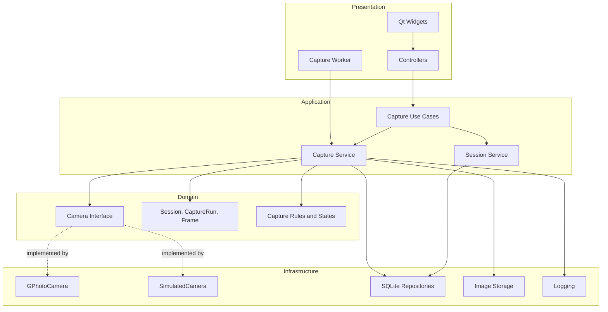
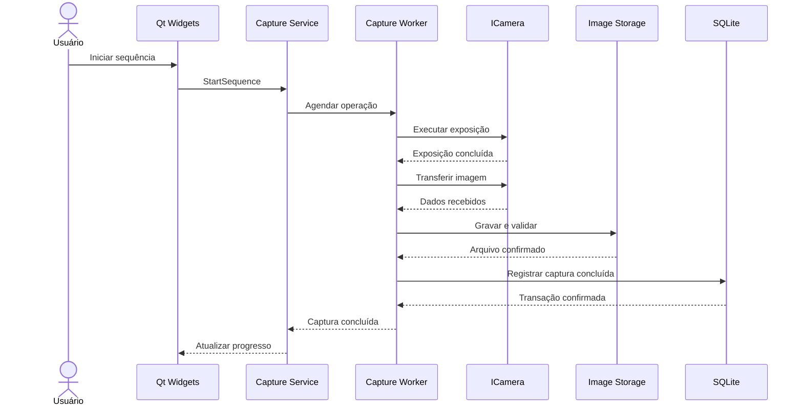

# AstroCapture — Arquitetura de Software

## 1. Visão geral

O AstroCapture é uma aplicação desktop para astrofotografia, desenvolvida em C++ com Qt 6 Widgets.

A arquitetura foi planejada para separar a interface gráfica, os casos de uso, as regras de negócio e as implementações de infraestrutura, permitindo evoluir os módulos de captura, empilhamento e edição de forma independente.

O desenvolvimento inicial será concentrado no módulo de captura, com suporte a câmeras físicas por meio da libgphoto2 e a câmeras simuladas para desenvolvimento e testes.

### Objetivos arquiteturais

- Manter a interface responsiva durante operações demoradas.
- Permitir testar o fluxo de captura sem hardware físico.
- Evitar dependência direta das regras de negócio em relação à libgphoto2.
- Preservar a integridade dos arquivos originais.
- Garantir persistência incremental dos metadados.
- Permitir interromper e retomar sessões de captura.
- Preparar a aplicação para incorporar empilhamento e edição.

## 2. Princípios arquiteturais

### Separação de responsabilidades

Cada componente deve possuir uma responsabilidade bem definida. A interface não deve executar operações diretamente na câmera, e a camada de domínio não deve depender de widgets ou de APIs específicas de hardware.

### Inversão de dependência

A lógica de aplicação deve depender de contratos e interfaces, e não diretamente das implementações concretas da câmera ou do banco de dados.

Por exemplo, o serviço de captura utiliza uma abstração de câmera. Em tempo de execução, essa abstração pode ser implementada por `GPhotoCamera` ou `SimulatedCamera`.

### Execução assíncrona

Exposições, transferências e outras operações demoradas devem ocorrer fora da thread principal do Qt.

### Persistência incremental

Cada captura concluída deve ser registrada individualmente. O sistema não deve depender do encerramento de uma sequência para salvar seu progresso.

### Testabilidade

As regras de negócio devem ser testáveis sem depender de câmera física, interface gráfica ou arquivos astronômicos reais.

## 3. Visão arquitetural



O diagrama representa os componentes lógicos previstos. A divisão final entre classes e arquivos poderá ser refinada durante a implementação.

## 4. Camadas da aplicação

### 4.1 Presentation

Responsável pela interação com o usuário.

Componentes previstos:

- `MainWindow`: janela principal e navegação.
- `CaptureView`: tela de captura.
- `SessionView`: criação e seleção de sessões.
- `CaptureController`: coordenação das ações da interface.
- `CaptureWorker`: execução das operações demoradas no contexto de trabalho.

A camada de apresentação pode utilizar Qt Widgets, Signals & Slots e modelos visuais do Qt.

**Restrições:**

- Não acessar a libgphoto2 diretamente.
- Não executar exposições ou transferências demoradas na thread principal.
- Não manipular diretamente o banco de dados.
- Não alterar o estado de domínio sem passar pelos casos de uso apropriados.

### 4.2 Application

Coordena os casos de uso e as operações da aplicação.

Serviços previstos:

- `CaptureService`: coordena capturas e sequências.
- `SessionService`: cria, abre, finaliza e retoma sessões.
- `CaptureSequenceService`: controla o ciclo de vida das sequências, caso sua separação seja necessária.
- `CaptureStatisticsService`: calcula os indicadores da sessão.

Casos de uso iniciais:

- `CreateSession`
- `OpenSession`
- `StartCapture`
- `StartSequence`
- `RequestStopSequence`
- `PauseSequence`
- `ResumeSequence`
- `StartLiveView`
- `StopLiveView`
- `GetSessionStatistics`

Os casos de uso deverão validar as solicitações e coordenar os componentes necessários sem incorporar detalhes específicos da interface.

### 4.3 Domain

Contém as entidades, os estados e as regras centrais do sistema.

Entidades previstas:

**Target**

Representa o alvo astronômico associado às sessões.

- Obrigatórios: identificador estável e nome.

**Session**

Representa uma sessão de trabalho associada a um alvo astronômico.

Informações principais:

- Obrigatórios: identificador, identificador do alvo, nome, etapa atual, data de criação e data da última atualização.
- Etapas: `Capture`, `Stacking`, `Editing` e `Finished`. A etapa representa o progresso no fluxo de trabalho; qualquer mudança entre etapas válidas é permitida, sem impor uma ordem fixa. Abrir ou fechar uma sessão é uma responsabilidade operacional distinta, não outro estado de domínio.

**CaptureRun**

Representa uma sequência de captura executada em determinada noite.

Informações principais:

- Obrigatórios: identificador, sessão associada, data de aquisição, tipo de quadro, tempo de exposição, modo de execução e estado.
- O ISO é opcional quando não disponível ou não aplicável.
- A quantidade planejada é obrigatória e positiva para sequências finitas; não se aplica ao modo contínuo.
- A quantidade concluída é derivada dos quadros associados, não armazenada como um segundo contador no domínio.

**Frame**

Representa uma imagem individual adquirida pela câmera.

Informações principais:

- Obrigatórios: identificador, sequência associada, tipo de quadro e estado.
- O tempo de exposição, ISO, data/hora da aquisição, caminho definitivo e tamanho do arquivo são opcionais enquanto o quadro ainda não os possui; exposição e ISO, quando informados, devem ser positivos.
- Um quadro só pode passar a `Completed` depois de ter caminho definitivo não vazio e tamanho maior que zero.

**CameraSettings**

Representa os parâmetros de configuração aplicáveis à câmera, respeitando as capacidades disponíveis.

**CameraCapabilities**

Representa os recursos que a câmera informa suportar, como configurações fotográficas e Live View.

### 4.4 Infrastructure

Contém as implementações concretas de recursos externos.

| Componente | Responsabilidade |
|---|---|
| `GPhotoCamera` | Comunicação com câmeras físicas pela libgphoto2. |
| `SimulatedCamera` | Simulação de conexão, exposição e transferência. |
| `SessionRepository` | Persistência de sessões. |
| `CaptureRunRepository` | Persistência das sequências. |
| `FrameRepository` | Persistência dos metadados das imagens. |
| `ImageStorage` | Gravação e organização dos arquivos. |
| `LoggingService` | Registro de eventos e erros. |

O domínio e os casos de uso não devem depender das classes concretas dessa camada.

## 5. Abstração de câmera

A aplicação utilizará um contrato comum para câmeras reais e simuladas.

Uma interface inicial poderá seguir esta estrutura:

```cpp
class ICamera {
public:
    virtual ~ICamera() = default;

    virtual CameraResult connect() = 0;
    virtual CameraResult disconnect() = 0;

    virtual CameraCapabilities capabilities() const = 0;
    virtual CameraSettings settings() const = 0;

    virtual CameraResult applySettings(
        const CameraSettings& settings
    ) = 0;

    virtual CaptureResult capture(
        const CaptureRequest& request
    ) = 0;

    virtual CameraResult startLiveView() = 0;
    virtual CameraResult stopLiveView() = 0;
};
```

`CameraResult`, `CaptureResult` e os demais tipos são contratos conceituais que deverão ser definidos no projeto.

A interface definitiva precisará considerar cancelamento, transferência de arquivos, consulta de estado e entrega de resultados de forma adequada à execução assíncrona.

### 5.1 GPhotoCamera

Será responsável por encapsular a API da libgphoto2.

Responsabilidades:

- Descobrir e conectar câmeras compatíveis.
- Consultar as capacidades disponíveis.
- Consultar e modificar configurações suportadas.
- Iniciar capturas e acompanhar sua conclusão.
- Transferir os arquivos da câmera para o dispositivo.
- Expor erros de comunicação e operações não suportadas.

Os recursos efetivamente disponíveis dependerão da câmera, do firmware e do driver utilizado.

### 5.2 SimulatedCamera

Implementará o mesmo contrato da câmera física.

**Modo básico:**

- Conexão e desconexão simuladas.
- Configurações fictícias.
- Capturas com duração simplificada.
- Utilização de imagens de teste.
- Respostas previsíveis para testes unitários.

**Modo realista:**

- Duração configurável das exposições.
- Atraso e progresso da transferência.
- Falhas injetáveis.
- Desconexão simulada.
- Interrupção de sequências.
- Testes de recuperação após operações incompletas.

Os testes deverão permitir controlar a ocorrência das falhas, evitando depender de comportamentos aleatórios.

## 6. Concorrência e comunicação

### 6.1 Thread principal

A thread principal será responsável por:

- Renderização da interface.
- Entrada do usuário.
- Atualização de widgets.
- Recebimento dos resultados dos casos de uso.

Nenhuma operação de hardware que possa bloquear deverá ser executada diretamente nessa thread.

### 6.2 Worker de captura

O worker executará as operações demoradas relacionadas à câmera e à transferência.

O fluxo lógico será:



O fluxo acima representa o caminho de sucesso. Falhas em cada etapa deverão produzir resultados explícitos e seguir as regras de recuperação.

### 6.3 Comunicação entre threads

A comunicação entre o worker e a aplicação deverá utilizar Signals & Slots do Qt com conexões apropriadas para a thread de destino.

Os widgets somente poderão ser acessados pela thread principal.

O controle da câmera física deverá ser serializado. Duas operações não poderão acessar simultaneamente a mesma instância de câmera.

A implementação também deverá definir como o worker será encerrado, como as operações pendentes serão drenadas e como a desconexão da câmera será coordenada.

## 7. Máquina de estados

A aplicação deverá distinguir o estado da sequência do estado de cada imagem.

### 7.1 Estados da sequência

| Estado | Descrição |
|---|---|
| `Ready` | Sequência preparada para iniciar. |
| `Running` | Sequência executando capturas. |
| `StopRequested` | Parada solicitada; nenhuma nova exposição deve começar. |
| `Paused` | Sequência interrompida e passível de retomada. |
| `Completed` | Todas as capturas planejadas foram concluídas. |
| `Failed` | A sequência encontrou uma falha que impede a continuação automática. |

### 7.2 Estados da imagem

| Estado | Descrição |
|---|---|
| `Pending` | Captura ainda não iniciada. |
| `Exposing` | Exposição em andamento. |
| `Transferring` | Arquivo sendo recebido. |
| `Validating` | Integridade e consistência sendo verificadas. |
| `Completed` | Arquivo salvo e metadados confirmados. |
| `Failed` | Captura ou processamento de transferência falhou. |

As transições deverão ser validadas explicitamente. Uma imagem só será considerada concluída depois que o arquivo estiver salvo e seu registro tiver sido confirmado.

### 7.3 Parada segura

Quando o usuário solicitar a parada de uma sequência:

1. A aplicação registra a solicitação.
2. Novas exposições deixam de ser agendadas.
3. Uma exposição em andamento é concluída normalmente.
4. A imagem é transferida e salva, se a operação puder ser concluída.
5. O resultado é registrado.
6. A sequência passa ao estado final de parada definido pelo caso de uso.

Se a transferência falhar, a aplicação registra o erro e permite recuperação. Não deverá afirmar que a imagem foi salva com sucesso quando isso não tiver sido confirmado.

## 8. Live View

O Live View terá controle manual e estado explícito.

Regras:

- Não pode ser ativado durante uma captura.
- Deve ser desativado antes do início de uma exposição, quando estiver ativo.
- Não será reativado automaticamente depois da captura.
- A interface só deve indicar Live View ativo quando a operação tiver sido confirmada.
- Erros ao iniciar ou parar o Live View devem ser apresentados ao usuário.

A implementação deverá verificar as limitações específicas de cada câmera e não presumir que todos os modelos suportem visualização remota.

## 9. Persistência e armazenamento

### 9.1 SQLite

O SQLite será utilizado para persistir os metadados e o histórico da aplicação.
O acesso será feito pelo módulo Qt SQL com o driver `QSQLITE`. A aplicação utilizará um banco único chamado `astrocapture.sqlite3` na pasta de dados do usuário indicada por `QStandardPaths::AppDataLocation`.

As migrações serão versionadas por `PRAGMA user_version` e executadas em transações. Os enums serão armazenados como texto, com restrições `CHECK` para os valores válidos. Timestamps serão serializados em ISO 8601 UTC. Chaves estrangeiras impedirão exclusões que deixem registros dependentes sem referência.

Tabelas previstas:

- `targets`
- `sessions`
- `capture_runs`
- `frames`

As relações entre essas tabelas deverão permitir consultar todas as imagens de uma sessão, suas sequências, as noites de aquisição e os parâmetros usados em cada captura.

O banco não será utilizado para armazenar os bytes das imagens.

### 9.2 Sistema de arquivos

As imagens serão organizadas sob `<AppDataLocation>/images/`, por alvo, sessão, data e tipo de quadro. O caminho usa IDs estáveis codificados em percent-encoding UTF-8; o diretório do alvo também inclui um slug legível normalizado em NFC. Arquivos são nomeados pelo ID do quadro e preservam a extensão original.

```text
<AppDataLocation>/
├── astrocapture.sqlite3
└── images/
    └── targets/
        └── <target-id>_<target-name-slug>/
            └── sessions/
                └── <session-id>/
                    └── nights/
                        └── YYYY-MM-DD/
                            └── <FrameType>/
                                └── <frame-id>[_NNN].<original-extension>
```

A sessão permanece a mesma entre noites, mas cada noite possui sua própria sequência de aquisição e seus diretórios.

O slug preserva letras e números Unicode normalizados em NFC, substituindo sequências de outros caracteres por hífens e usando `target` quando resultar vazio. Se um caminho calculado já existir, acrescenta-se `_001`, `_002` e assim sucessivamente antes da extensão. O layout apenas calcula caminhos; não cria nem reserva arquivos. A gravação deve impedir sobrescritas em condições de concorrência.

O SQLite será a fonte principal dos metadados gerenciados pela aplicação. Um eventual `session.json` será apenas manifesto auxiliar.

### 9.3 Integridade das imagens

O processo de armazenamento deverá:

1. Criar um nome de arquivo que não sobrescreva imagens existentes.
2. Receber a imagem em um arquivo temporário no destino.
3. Validar o tamanho e a conclusão da transferência.
4. Preservar os bytes e a extensão original do arquivo.
5. Promover o arquivo temporário ao destino definitivo.
6. Registrar os metadados em uma transação SQLite.
7. Atualizar o estado da imagem para `Completed`.

Sempre que possível, a promoção do arquivo temporário deverá utilizar uma operação atômica no mesmo sistema de arquivos.

O sistema deverá tratar o caso em que o arquivo tenha sido gravado, mas a transação SQLite não tenha sido confirmada. A recuperação poderá reconciliar o arquivo com os registros pendentes, sem sobrescrever imagens existentes.

### 9.4 Estatísticas

As estatísticas deverão ser calculadas a partir dos registros persistidos.

Indicadores previstos:

- Total de imagens concluídas.
- Quantidade por tipo de quadro.
- Tempo acumulado de exposição.
- Quantidade de falhas.
- Estado da sequência atual.

O tempo acumulado deverá considerar somente exposições efetivamente concluídas e registradas.

## 10. Recuperação após interrupções

O AstroCapture deverá ser capaz de identificar operações incompletas quando uma sessão for reaberta.

Na inicialização ou abertura da sessão, a aplicação deverá:

1. Consultar o estado persistido da sequência.
2. Identificar imagens em estados intermediários.
3. Verificar arquivos temporários e arquivos definitivos associados.
4. Comparar os arquivos encontrados com os registros no SQLite.
5. Marcar inconsistências para recuperação ou revisão.
6. Apresentar as opções de continuidade ao usuário.

Se uma sequência tiver sido interrompida, o usuário deverá poder escolher entre:

- Retomar as capturas restantes.
- Iniciar uma nova sequência na mesma sessão.
- Cancelar a operação e retornar ao menu.

A aplicação não deverá presumir que uma exposição interrompida produziu uma imagem válida, nem repetir automaticamente uma captura cuja conclusão seja desconhecida.

## 11. Logs e diagnóstico

O sistema deverá registrar eventos importantes para diagnóstico e recuperação.

Informações previstas:

- Data e hora.
- Sessão e sequência relacionadas.
- Operação executada.
- Estado anterior e estado resultante, quando relevante.
- Código de erro, quando disponível.
- Descrição da falha.
- Caminho do arquivo envolvido, quando aplicável.

Os logs de aquisição poderão ser organizados por noite dentro da pasta da sessão.

Os registros deverão ajudar a investigar problemas de conexão, exposição, transferência, gravação e persistência.

## 12. Testabilidade

A arquitetura deverá permitir testes em diferentes níveis.

### Testes unitários

Validam regras de domínio e transições de estado sem depender de hardware ou interface gráfica.

### Testes de aplicação

Validam casos de uso utilizando implementações simuladas das interfaces externas.

### Testes de integração

Validam a interação entre o serviço de captura, SQLite e armazenamento de arquivos.

### Testes de hardware

Validam a integração real com câmeras compatíveis, incluindo conexão, configurações, captura, transferência e Live View quando suportado.

A simulação realista deverá permitir reproduzir falhas específicas, como desconexão durante transferência, falta de espaço e erro de gravação.

## 13. Organização do código

```text
src/
├── app/
├── domain/
│   ├── camera/
│   ├── capture/
│   ├── session/
│   └── image/
├── application/
│   ├── capture/
│   └── session/
├── infrastructure/
│   ├── camera/
│   │   ├── gphoto/
│   │   └── simulator/
│   ├── persistence/
│   └── storage/
└── presentation/
    ├── windows/
    ├── views/
    ├── widgets/
    └── workers/
```

A estrutura representa uma organização inicial. Novos diretórios ou abstrações deverão ser introduzidos quando houver uma necessidade concreta, evitando complexidade prematura.

## 14. Evolução arquitetural

A arquitetura deverá acomodar os módulos futuros sem exigir que eles façam parte do primeiro marco funcional.

### Empilhamento

O módulo de empilhamento deverá consumir imagens e metadados persistidos, sem depender do fluxo de captura estar ativo.

### Edição

O módulo de edição deverá trabalhar sobre representações processáveis das imagens e manter os arquivos originais preservados.

### Extensibilidade

Novos modelos de câmera e novos métodos de processamento deverão ser incorporados por interfaces e serviços específicos, evitando espalhar dependências de hardware ou processamento pelo restante da aplicação.

## 15. Critérios de conclusão do primeiro marco

O primeiro marco arquitetural será considerado validado quando:

- A aplicação criar, salvar, abrir e retomar sessões.
- A câmera simulada executar capturas individuais e sequências.
- A interface permanecer responsiva durante as operações.
- A parada segura impedir novas exposições sem descartar deliberadamente a imagem em andamento.
- Os arquivos forem gravados individualmente e preservados.
- Os metadados forem confirmados no SQLite.
- As falhas de transferência e gravação forem identificadas.
- O estado da sessão puder ser recuperado após o encerramento da aplicação.
- Os testes automatizados validarem os principais fluxos e cenários de erro.

---

**Status:** arquitetura proposta para orientar a implementação inicial do AstroCapture. Detalhes de classes, interfaces e persistência poderão ser refinados durante o desenvolvimento, preservando os princípios e requisitos definidos neste documento.