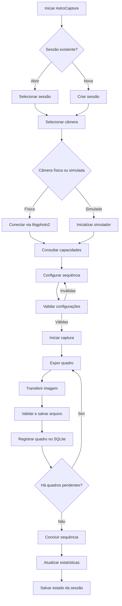
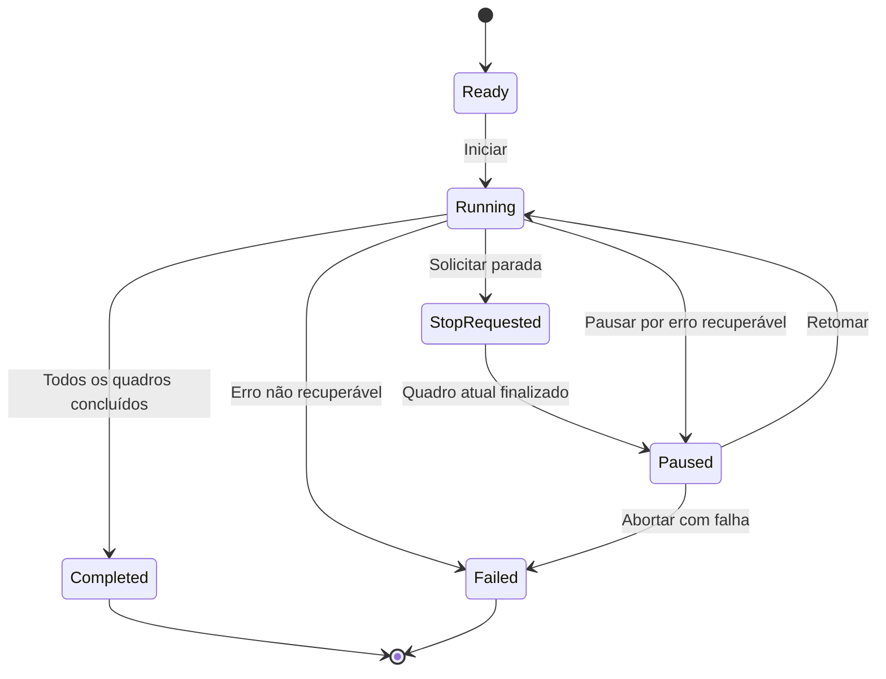
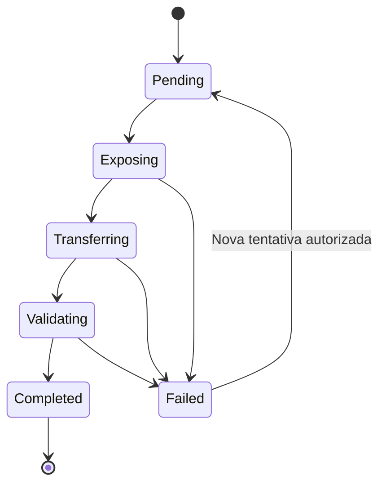

# Fluxo de Captura — AstroCapture

## 1. Objetivo

Este documento descreve o fluxo de captura do AstroCapture, desde a criação de uma sessão até a conclusão e persistência das imagens capturadas.

O objetivo é garantir que o processo seja confiável, recuperável após interrupções e independente do modelo de câmera utilizado sempre que possível.

O fluxo deve funcionar tanto com uma câmera física, por meio do `libgphoto2`, quanto com uma câmera simulada para desenvolvimento e testes.

## 2. Escopo

O módulo de captura contempla:

- Criação e abertura de sessões de captura.
- Conexão com uma câmera física ou simulada.
- Consulta e configuração dos recursos suportados pela câmera.
- Capturas individuais, sequências com quantidade definida e capturas contínuas.
- Classificação dos quadros por tipo.
- Transferência e armazenamento das imagens.
- Pré-visualização da última imagem capturada.
- Acompanhamento do progresso e das estatísticas.
- Registro de erros e recuperação de operações interrompidas.
- Retomada de sessões em outra noite.

O empilhamento e a edição das imagens fazem parte de módulos posteriores.

## 3. Conceitos principais

### 3.1 Sessão

Uma sessão representa o conjunto de capturas associado a um alvo astronômico.

Cada sessão possui:

- Identificador único.
- Nome informado pelo usuário.
- Data de criação.
- Estado atual.
- Uma ou mais noites de captura.
- Uma ou mais sequências de captura.
- Referências aos quadros capturados.
- Estatísticas acumuladas.

Uma sessão pode permanecer aberta durante várias noites. A cada nova noite, o sistema registra uma nova data de observação, sem misturar os registros de noites diferentes.

### 3.2 Sequência de captura

Uma sequência representa uma operação de captura configurada pelo usuário.

Ela contém:

- Tipo de quadro: Light, Dark, Flat, Bias ou Dark Flat.
- Configurações de exposição.
- ISO, quando suportado.
- Quantidade planejada de quadros, quando aplicável.
- Modo de execução.
- Estado atual.
- Quadros concluídos, pendentes ou com falha.

### 3.3 Quadro

Um quadro representa uma imagem individual produzida durante uma captura.

Cada quadro deve possuir um identificador único e registrar, quando disponíveis:

- Sessão e sequência de origem.
- Tipo de quadro.
- Nome e caminho do arquivo.
- Data e hora da captura.
- Tempo de exposição.
- ISO.
- Estado da operação.
- Tamanho do arquivo.
- Informações de validação.
- Mensagens de erro, quando houver.

O quadro só pode ser considerado concluído quando o arquivo tiver sido transferido, validado, salvo e registrado no banco de dados.

## 4. Fluxo geral



O fluxo representa o caminho normal. Falhas, pedidos de parada e interrupções devem ser tratados por estados próprios, descritos nas seções seguintes.

## 5. Criação e abertura da sessão

### 5.1 Nova sessão

O usuário informa o nome do alvo ou da sessão e seleciona o fluxo de trabalho desejado.

O sistema deve:

1. Validar os campos obrigatórios.
2. Gerar um identificador único para a sessão.
3. Persistir o alvo e a sessão aberta no SQLite em uma única transação.
4. Criar a estrutura de diretórios da sessão.
5. Registrar a noite de captura quando a primeira operação for iniciada.
6. Abrir a tela de captura.

A criação da sessão não deve exigir uma câmera conectada. Isso permite preparar sessões e utilizar o simulador.
O estado aberto/fechado é operacional e independente da etapa de trabalho da sessão. Ele permanece persistido entre reinicializações; fechar e reabrir uma sessão não altera sua etapa. Abrir ou fechar uma sessão já nesse estado é idempotente.

### 5.2 Abrir sessão existente

Ao abrir uma sessão, o sistema carrega:

- Dados gerais da sessão.
- Noites registradas.
- Sequências anteriores.
- Quadros concluídos.
- Sequências incompletas.
- Estatísticas acumuladas.
- Histórico de erros relevantes.

O sistema deve reconciliar o estado persistido com os arquivos existentes, identificando possíveis inconsistências sem sobrescrever ou excluir dados silenciosamente.

### 5.3 Retomar uma sessão interrompida

Se houver uma sequência incompleta, o sistema deve oferecer três opções:

- **Continuar:** retomar os quadros pendentes, após validar a situação da câmera e dos arquivos.
- **Nova sequência:** preservar a sequência anterior e criar outra.
- **Cancelar:** não iniciar nenhuma captura.

Quadros já concluídos não devem ser capturados novamente automaticamente.

## 6. Conexão e preparação da câmera

O sistema oferece duas implementações da mesma abstração de câmera:

- `GPhotoCamera`: controla a câmera física por meio do `libgphoto2`.
- `SimulatedCamera`: reproduz o comportamento da câmera sem exigir hardware.

Após a seleção, o sistema deve:

1. Inicializar o adaptador escolhido.
2. Verificar se a câmera está acessível.
3. Consultar as capacidades disponíveis.
4. Obter os valores atuais das configurações.
5. Identificar quais parâmetros podem ser alterados.
6. Apresentar as opções disponíveis na interface.

A interface não deve presumir que todas as câmeras oferecem os mesmos recursos. ISO, tempo de exposição, Live View, cancelamento de exposição e outros controles dependem do modelo e do suporte disponibilizado pelo adaptador.

Se a conexão falhar, o usuário deve receber uma mensagem compreensível e a opção de tentar novamente ou utilizar o simulador.

## 7. Configuração da sequência

Antes de iniciar uma sequência, o usuário configura:

- Tipo de quadro.
- Modo de captura.
- Quantidade de imagens, quando aplicável.
- Tempo de exposição.
- ISO, quando suportado.
- Outros parâmetros disponibilizados pela câmera.

### 7.1 Tipos de quadro

| Tipo | Finalidade |
|---|---|
| Light | Imagem principal do alvo astronômico. |
| Dark | Registro do ruído do sensor usando uma exposição compatível, sem entrada de luz. |
| Flat | Registro da iluminação não uniforme e de características ópticas, como vinhetas e poeira. |
| Bias | Registro do sinal de leitura do sensor, usando o menor tempo de exposição suportado. |
| Dark Flat | Registro do ruído de uma exposição compatível com os quadros Flat. |

O sistema deve armazenar o tipo de quadro como metadado, independentemente do nome do diretório ou do arquivo.

### 7.2 Validação

Antes de executar a sequência, validar:

- Compatibilidade dos parâmetros com a câmera.
- Quantidade de quadros, quando aplicável.
- Tempo de exposição válido.
- Existência de espaço disponível para os arquivos, quando for possível estimá-lo.
- Permissão de escrita no diretório da sessão.
- Ausência de conflitos de nomes.
- Disponibilidade do dispositivo e do adaptador.

Parâmetros incompatíveis devem ser apresentados ao usuário antes do início da captura.

## 8. Execução da captura

A captura deve ocorrer fora da thread principal da interface gráfica. A comunicação com a câmera deve ser serializada para evitar chamadas concorrentes ao `libgphoto2`.

### 8.1 Captura de um quadro

Para cada quadro, executar as seguintes etapas:

1. Criar o registro inicial do quadro como pendente.
2. Aplicar as configurações necessárias.
3. Solicitar a exposição à câmera.
4. Aguardar o término da exposição.
5. Solicitar e transferir o arquivo.
6. Gravar o arquivo em um destino temporário.
7. Validar o resultado da transferência.
8. Finalizar o arquivo no destino definitivo.
9. Registrar os metadados e o estado concluído no SQLite.
10. Atualizar a interface e as estatísticas.

O arquivo temporário e o registro de estado permitem detectar operações incompletas após uma falha.

O sistema deve preservar os bytes do arquivo original e sua extensão original. Para arquivos RAW da Canon T6, por exemplo, a extensão esperada normalmente é `.CR2`. O AstroCapture não deve converter ou recomprimir o arquivo original durante a captura.

### 8.2 Sequência com quantidade definida

Em uma sequência de quantidade definida, o sistema repete o processo de captura até que todos os quadros tenham sido concluídos ou até que ocorra uma interrupção.

O progresso deve considerar os quadros efetivamente concluídos, não apenas as exposições iniciadas.

Exemplo: em uma sequência de 20 quadros, se 7 forem concluídos e o oitavo falhar, o progresso confirmado será de 7/20.

### 8.3 Captura contínua

Na captura contínua, o sistema inicia novos quadros até que o usuário solicite a parada ou ocorra uma condição de erro.

Ao solicitar a parada:

1. Marcar a sequência como `StopRequested`.
2. Não agendar novas exposições.
3. Permitir que a exposição em andamento termine.
4. Tentar transferir e salvar o quadro atual.
5. Registrar o resultado da operação.
6. Encerrar a sequência em estado apropriado.

O sistema não deve presumir que consegue cancelar fisicamente uma exposição já iniciada. A interrupção imediata depende do suporte da câmera.

## 9. Máquina de estados

### 9.1 Sequência



Significado dos estados:

- `Ready`: sequência validada, aguardando início.
- `Running`: executando capturas.
- `StopRequested`: aguardando a conclusão segura do quadro atual.
- `Paused`: execução suspensa, aguardando decisão ou retomada.
- `Completed`: todos os quadros planejados foram concluídos.
- `Failed`: ocorreu uma falha que impediu a continuidade normal.

Uma sequência contínua interrompida pelo usuário não deve ser marcada como concluída se não houver uma condição explícita de conclusão definida para esse modo.

### 9.2 Quadro



A repetição de uma tentativa deve ser registrada. Um quadro concluído não pode voltar para pendente automaticamente.

## 10. Transferência, armazenamento e integridade

### 10.1 Organização dos arquivos

Os dados da aplicação ficam na pasta de dados do usuário. A raiz das imagens é o subdiretório `images/`, organizado por identificadores estáveis de alvo, sessão e quadro:

```text
<AppDataLocation>/
├── astrocapture.sqlite3
└── images/
    └── targets/
        └── <target-id>_<target-name-slug>/
            └── sessions/
                └── <session-id>/
                    └── nights/
                        └── YYYY-MM-DD/
                            └── <FrameType>/
                                └── <frame-id>[_NNN].<original-extension>
```

O slug do alvo preserva letras e números Unicode normalizados em NFC; sequências de outros caracteres viram um hífen e hífens nas pontas são removidos. Se o nome não produzir um slug, usa-se `target`. Identificadores são codificados em percent-encoding UTF-8 para que não alterem a estrutura dos diretórios. A distinção entre IDs garante que alvos ou sessões com nomes iguais não misturem arquivos.

O tipo do quadro é armazenado como metadado e seu diretório usa um dos nomes `Light`, `Dark`, `Flat`, `Bias` ou `DarkFlat`. O arquivo usa o ID do quadro e mantém a extensão original, inclusive a capitalização. A geração do caminho não cria diretórios nem arquivos.

Se o nome calculado já existir, o layout procura o primeiro nome disponível acrescentando `_001`, `_002` e assim sucessivamente antes da extensão. A geração do caminho não reserva o nome; o componente que grava o arquivo deve continuar impedindo sobrescritas em caso de concorrência.

### 10.2 Gravação segura

A implementação deve:

- Evitar sobrescrever arquivos existentes sem autorização explícita.
- Utilizar nomes de arquivo únicos ou identificadores de quadro.
- Gravar primeiro em arquivo temporário.
- Verificar se a transferência e a gravação foram concluídas.
- Renomear o temporário para o destino definitivo.
- Registrar o quadro como concluído no banco de dados somente após as verificações necessárias.
- Registrar erros de disco cheio, falta de permissão ou transferência incompleta.

A renomeação atômica depende do sistema de arquivos e deve ocorrer, preferencialmente, dentro do mesmo sistema de arquivos.

O banco SQLite e o sistema de arquivos não compartilham uma única transação. Portanto, a recuperação deve lidar explicitamente com arquivos definitivos sem registro no banco e registros pendentes sem arquivo válido.

### 10.3 Validação

A validação inicial deve verificar, no mínimo:

- Existência do arquivo.
- Tamanho não nulo.
- Tamanho consistente com o resultado da transferência, quando conhecido.
- Possibilidade de leitura do arquivo.
- Consistência entre o caminho salvo e o registro do quadro.

Quando possível, calcular um hash do arquivo para facilitar verificações futuras de integridade. Um arquivo com tamanho válido não é necessariamente uma imagem astronomicamente utilizável; verificações de conteúdo mais avançadas podem ser adicionadas posteriormente.

## 11. Live View e pré-visualização

O Live View e a pré-visualização da última imagem capturada são funcionalidades distintas.

### 11.1 Live View

O Live View deve:

- Ser iniciado manualmente pelo usuário.
- Ser disponibilizado somente quando suportado pela câmera.
- Ser desativado enquanto uma captura estiver em andamento.
- Não ser reativado automaticamente após o término de uma captura.
- Ser encerrado de forma controlada ao desconectar a câmera ou fechar a aplicação.

A interface deve impedir que o usuário inicie o Live View enquanto a câmera estiver ocupada com uma captura.

### 11.2 Pré-visualização da última imagem

Após a conclusão de um quadro, o sistema pode gerar ou carregar uma pré-visualização para exibição.

A pré-visualização não deve substituir nem alterar o arquivo RAW original. Se for necessário converter uma imagem para exibição, o resultado deve ser armazenado separadamente ou mantido em memória.

A geração de miniaturas e a decodificação de imagens não devem bloquear a interface gráfica.

## 12. Estatísticas e progresso

A interface deve apresentar informações da sequência atual e da sessão.

### Sequência atual

- Quantidade planejada, quando aplicável.
- Quantidade concluída.
- Quantidade pendente.
- Quantidade com falha.
- Quadro em andamento.
- Progresso geral.
- Tempo de exposição configurado.
- Tempo total decorrido.

### Sessão

- Total de quadros concluídos.
- Quantidade por tipo de quadro.
- Tempo total de exposição acumulado.
- Quantidade de sequências.
- Datas das noites registradas.
- Última captura concluída.

O tempo total de exposição deve ser calculado a partir dos quadros concluídos, utilizando seus metadados registrados. Tempo de transferência e tempo de espera não devem ser contabilizados como exposição.

## 13. Tratamento de falhas

A política inicial de recuperação é pausar a sequência e solicitar uma decisão ao usuário quando a falha puder ser tratada com segurança.

| Falha | Comportamento esperado |
|---|---|
| Câmera desconectada | Interromper novos disparos e preservar o estado da sequência. |
| Falha na exposição | Registrar o erro e solicitar uma decisão. |
| Falha na transferência | Preservar o diagnóstico e evitar marcar o quadro como concluído. |
| Arquivo inválido | Não contabilizar o quadro como concluído. |
| Falta de espaço | Interromper novas capturas e informar o usuário. |
| Falha no SQLite | Não confirmar silenciosamente o quadro como persistido. |
| Aplicação encerrada inesperadamente | Recuperar o estado a partir do banco, dos arquivos e dos registros disponíveis. |

As opções de recuperação podem incluir tentar novamente, pausar, encerrar a sequência ou desconectar e reconectar a câmera.

O sistema não deve repetir uma exposição automaticamente quando não for possível determinar se a câmera já a executou. Essa decisão deve considerar o estado da operação e a possibilidade de duplicar uma imagem.

## 14. Persistência no SQLite

O SQLite será a fonte principal dos metadados da captura.

As tabelas iniciais previstas são:

- `targets`: alvos astronômicos.
- `sessions`: sessões de observação.
- `capture_runs`: sequências de captura.
- `frames`: quadros individuais.

O banco deve registrar alterações de estado importantes, parâmetros de captura, caminhos de arquivos e mensagens de erro relevantes.

A aplicação deve usar transações para operações relacionadas aos metadados e definir uma política de recuperação para divergências entre banco e disco.

O arquivo `session.json`, se utilizado, será complementar e não deverá competir com o SQLite como fonte de verdade.

## 15. Simulação de câmera

O simulador deve implementar a mesma interface pública da câmera física, permitindo executar o fluxo completo sem equipamento conectado.

### Modo básico

Deve permitir:

- Conectar e desconectar virtualmente.
- Configurar parâmetros suportados pelo simulador.
- Capturar quadros de teste.
- Executar sequências.
- Transferir arquivos de exemplo ou gerar imagens de teste.
- Validar a persistência da sessão.

### Modo realista

Além das funções básicas, deve permitir configurar:

- Tempo de exposição simulado.
- Tempo de transferência.
- Progresso de transferência.
- Falha de exposição.
- Falha de transferência.
- Desconexão simulada.
- Arquivo inválido.
- Interrupção durante uma sequência.

As falhas devem poder ser reproduzidas em testes, preferencialmente por configuração, para que os cenários não dependam de comportamento aleatório.

## 16. Registro e diagnóstico

Cada sequência deve possuir um identificador que permita relacionar seus eventos.

Os registros devem incluir:

- Inicialização e encerramento da sequência.
- Configurações utilizadas.
- Início e término das exposições.
- Início e conclusão das transferências.
- Caminhos dos arquivos.
- Alterações de estado.
- Solicitações de parada.
- Erros e tentativas de recuperação.

As mensagens devem ser úteis para diagnóstico sem registrar informações desnecessárias. Erros técnicos detalhados podem ser mantidos nos logs, enquanto a interface apresenta mensagens objetivas ao usuário.

Os logs usam JSON Lines no arquivo `<AppDataLocation>/logs/astrocapture.jsonl`, com timestamps UTC em microssegundos e severidades `INFO`, `WARNING` e `ERROR`. Cada evento pode incluir IDs de sessão, sequência e quadro, operação, estados anterior/atual, código e detalhes técnicos, caminho relativo ao diretório de dados e configurações tipadas da captura. A escrita é serializada entre threads; arquivos de 10 MiB são rotacionados, mantendo até cinco backups. Falhas de gravação são propagadas. Não registrar payloads arbitrários, variáveis de ambiente ou credenciais.

## 17. Critérios de aceitação

O fluxo de captura será considerado pronto para a primeira versão quando:

1. O usuário conseguir criar, salvar, fechar e reabrir uma sessão.
2. O simulador permitir capturar um único quadro e sequências com quantidade definida.
3. A captura contínua puder ser interrompida sem agendar novas exposições após a solicitação de parada.
4. Cada quadro concluído possuir arquivo válido e metadados persistidos.
5. O arquivo original for preservado sem conversão ou recompressão.
6. Os tipos Light, Dark, Flat, Bias e Dark Flat forem registrados corretamente.
7. O progresso e as estatísticas forem atualizados com base nos quadros concluídos.
8. Uma falha não fizer o sistema marcar uma captura incompleta como concluída.
9. Uma sessão puder ser retomada sem duplicar automaticamente quadros já concluídos.
10. O Live View não puder ser iniciado durante uma captura e não for reativado automaticamente após ela.
11. O simulador realista permitir testar falhas de maneira reproduzível.
12. A interface continuar responsiva durante exposição, transferência e gravação.

## 18. Fora do escopo inicial

Não fazem parte da primeira implementação do fluxo de captura:

- Empilhamento de imagens.
- Calibração automática de quadros.
- Edição avançada.
- Processamento completo de arquivos RAW.
- Controle de montagem equatorial.
- Autoguiagem.
- Planejamento automático de sessões astronômicas.

Essas funcionalidades poderão ser integradas futuramente sem comprometer a separação entre captura, armazenamento e processamento.

## 19. Próximos passos de implementação

A ordem recomendada é:

1. Definir as entidades de sessão, sequência e quadro.
2. Definir a interface `ICamera`.
3. Implementar o `SimulatedCamera` básico.
4. Criar o armazenamento de arquivos e o repositório SQLite.
5. Implementar a máquina de estados da captura.
6. Integrar o fluxo à interface Qt por meio de uma thread de trabalho.
7. Implementar recuperação de sequências interrompidas.
8. Adicionar falhas reproduzíveis ao simulador realista.
9. Implementar pré-visualização e Live View.
10. Integrar a câmera física via `libgphoto2` e validar cada recurso suportado.

A integração física deve ocorrer depois que o fluxo principal puder ser validado com o simulador, reduzindo a dependência do hardware durante o desenvolvimento.